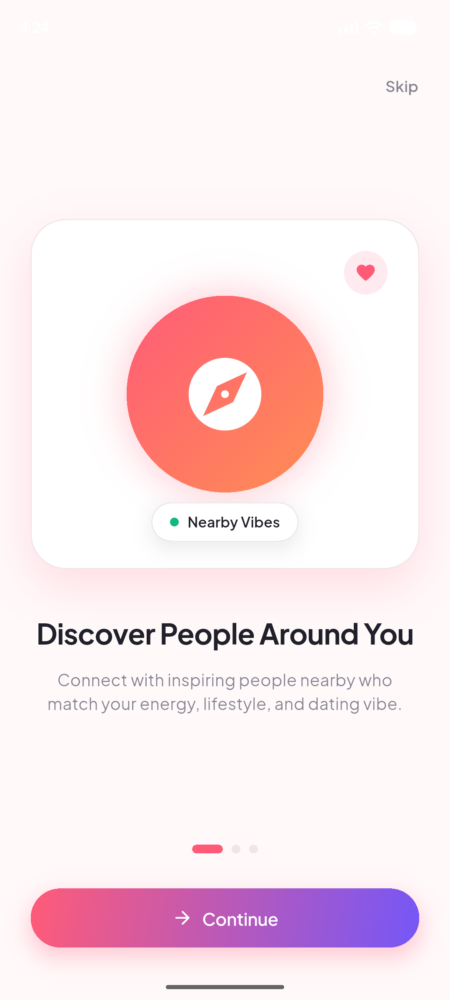
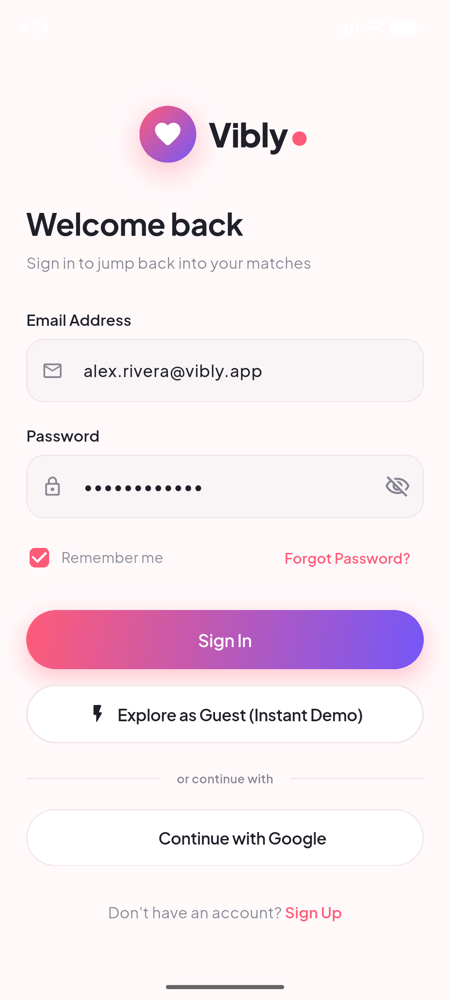
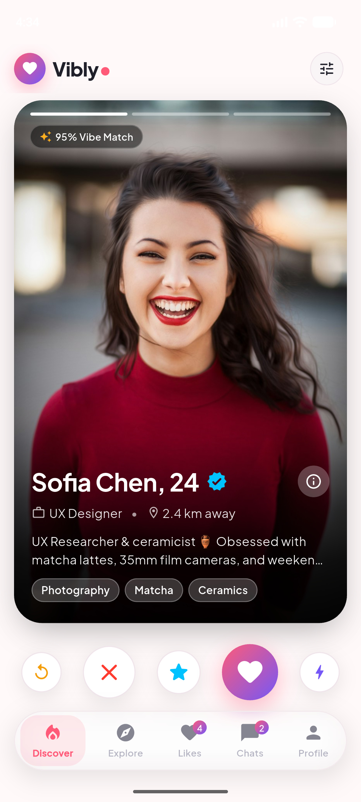
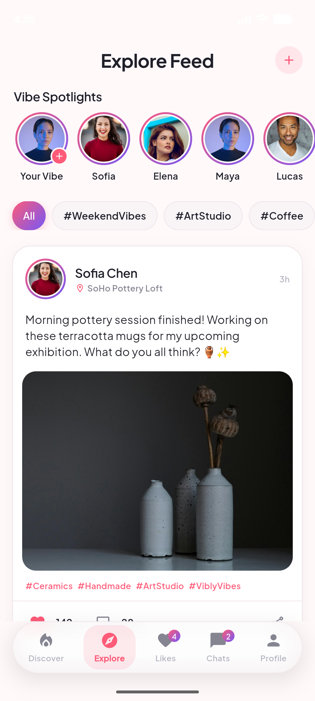
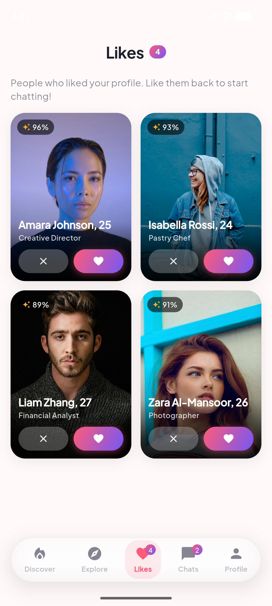
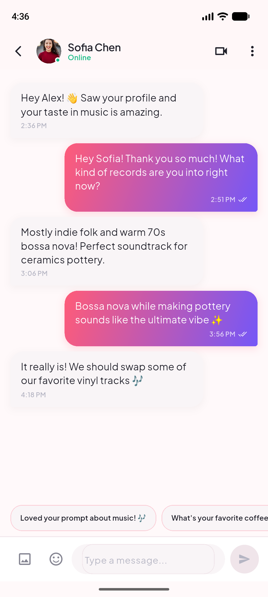
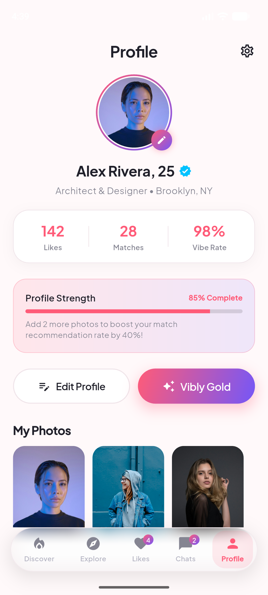

# Vibly — Dating & Social Networking App

<div align="center">


### **Meet people. Find your vibe.**

[](https://flutter.dev)
[](https://dart.dev)
[](https://riverpod.dev)
[](https://pub.dev/packages/go_router)
[](LICENSE)

A modern, high-performance mobile application engineered with Flutter, Riverpod, and GoRouter, combining the best of swipe-based matchmaking with an interactive social networking community feed.

</div>

---

## 📸 App Showcase

<div align="center">
  <table>
    <tr>
      <td align="center"><b>Onboarding</b></td>
      <td align="center"><b>Authentication</b></td>
      <td align="center"><b>Swipe & Discover</b></td>
    </tr>
    <tr>
      <td></td>
      <td></td>
      <td></td>
    </tr>
    <tr>
      <td align="center"><b>Explore Feed</b></td>
      <td align="center"><b>Likes Received</b></td>
    </tr>
    <tr>
      <td></td>
      <td></td>
    </tr>
    <tr>
      <td></td>
      <td></td>
    </tr>
  </table>
</div>

---

## ✨ Key Features

### 🎴 1. Swipe-Based Discovery
- **Card Physics**: Smooth drag gesture physics with dynamic card tilt, spring-back animations, and rotation interpolation.
- **Visual Stamps**: Real-time reactive opacity stamps for **LIKE** (Emerald), **NOPE** (Coral), and **SUPER LIKE** (Electric Cyan).
- **Photo Carousel**: Micro-tap left/right navigation on profile images with dynamic progress indicators.
- **Match Dialog**: Celebration modal with matching animation, direct chat navigation, and confetti styling.
- **Preferences & Filters**: Modal slider controls for maximum distance, age ranges, gender interest, and verified badges.

### 🧭 2. Social Explore Feed
- **Vibe Spotlights**: Horizontal interactive story row for featured users.
- **Dynamic Hashtags**: Real-time feed filtering by trending community topics (`#WeekendVibes`, `#Coffee`, `#ArtStudio`).
- **Post Interaction**: Interactive like count animation, comment sheets, and sharing mechanics.
- **Publishing**: Modal creator to share photos, captions, locations, and hashtags.

### 💌 3. Likes & Matching
- Dedicated grid displaying users who liked your profile.
- Mutual match creation with instant conversation creation.
- Compatibility score pill indicators (e.g. *96% Vibe Match*).

### 💬 4. Real-time Chat & Messaging
- Online presence badges and typing indicator simulations.
- Read receipts (double checkmarks) and message timestamps.
- Quick icebreaker conversation starter chips.
- Safety controls including **Block & Report** functionality.

### 👤 5. Profile & Personalization
- Multi-step profile setup with strict **18+ community age verification**.
- Profile strength progress bar.
- Stats counters (Likes, Matches, Vibe Score).
- Light and Dark mode toggle with instant persistence via Riverpod.

---

## 🎨 Design System & Brand Identity

| Token | Hex | Role |
| :--- | :--- | :--- |
| **Primary** | `#FF5B78` | Coral Pink (Brand Accent & Buttons) |
| **Secondary** | `#7557F7` | Electric Purple (Gradients & Secondary Accents) |
| **Super Like** | `#00C2FF` | Electric Cyan |
| **Match / Success** | `#10B981` | Emerald Green |
| **Background (Light)** | `#FFF9FA` | Soft Pink White |
| **Card (Light)** | `#FFFFFF` | Pure White |
| **Background (Dark)** | `#121118` | Midnight Plum |
| **Card (Dark)** | `#1C1A26` | Deep Slate |
| **Typography** | — | Plus Jakarta Sans |

---

## 🏗️ Architecture

```
lib/
├── core/
│   ├── constants/       # AppColors, AppGradients, AppTypography, AppStrings
│   ├── router/          # GoRouter configuration & route definitions
│   ├── theme/           # Light & Dark ThemeData, theme mode notifier
│   └── widgets/         # Reusable design system primitives (buttons, avatars, inputs)
├── data/
│   ├── mock/            # Curated mock dataset with realistic profiles & posts
│   ├── models/          # UserProfile, SocialPost, ChatMessage, MatchItem
│   └── repositories/    # StateNotifier providers for reactive data streams
└── features/
    ├── auth/            # Login, Signup, Forgot Password screens
    ├── chat/            # Chat list, 1-on-1 messaging screen, chat bubbles
    ├── discover/        # Swipeable card stack, action buttons, filter & match modals
    ├── explore/         # Social feed, story spotlights, comment & post sheets
    ├── likes/           # Who liked you grid & match-back mechanics
    ├── main_nav/        # Frosted glass floating bottom navigation bar
    ├── onboarding/      # 3-step animated onboarding carousel
    ├── profile/         # User profile, edit profile, and settings screens
    ├── profile_setup/   # 3-step profile builder with 18+ age verification
    └── splash/          # Animated logo splash screen
```

---

## 🚀 Getting Started

### Prerequisites
- Flutter SDK `^3.41.0` or later
- Dart SDK `^3.11.0` or later
- Android Studio / Xcode / VS Code

### Installation

1. **Clone the repository:**
   ```bash
   git clone git@github.com:trydigital2/vibly.git
   cd vibly
   ```

2. **Install dependencies:**
   ```bash
   flutter pub get
   ```

3. **Verify compilation:**
   ```bash
   flutter analyze
   flutter test
   ```

4. **Run the application:**
   ```bash
   # Run on an Android emulator or device
   flutter run -d android

   # Run on iOS simulator
   flutter run -d ios

   # Run on macOS desktop
   flutter run -d macos
   ```

---

## 🧪 Testing

Execute the comprehensive test suite:
```bash
flutter test
```

---

## 📄 License

This project is licensed under the MIT License.
